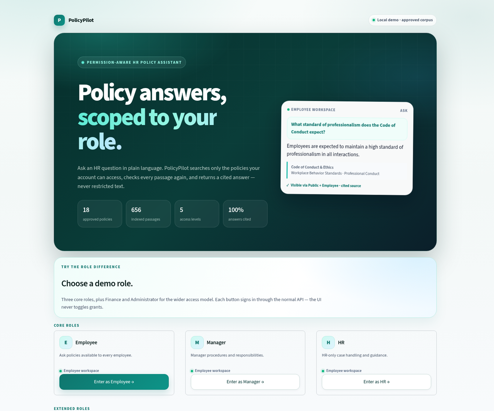
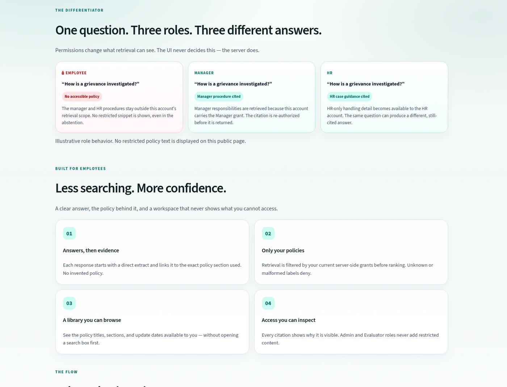
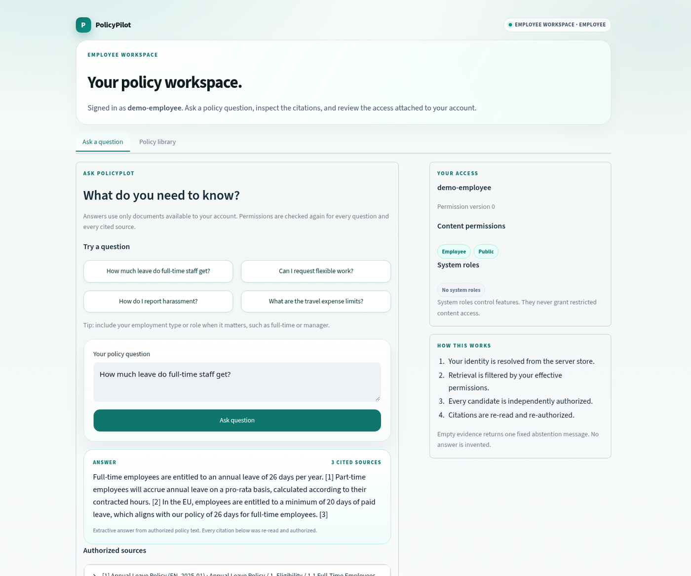
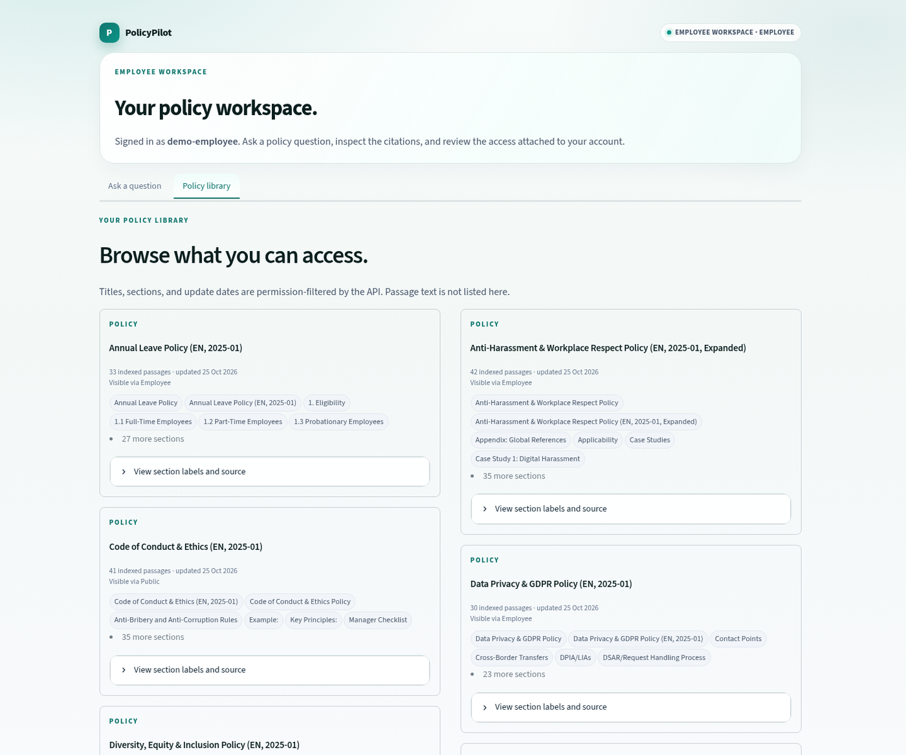
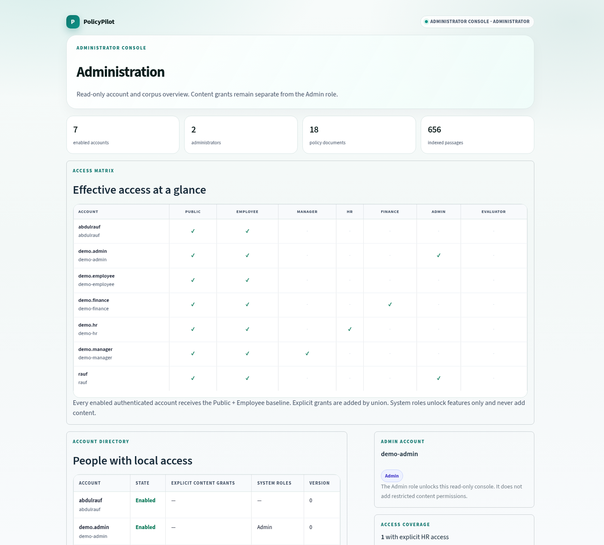
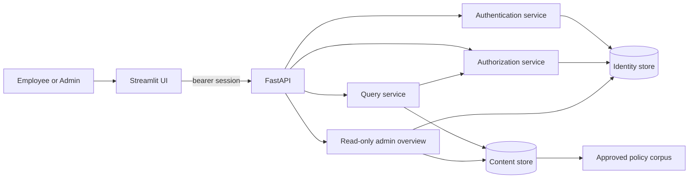

# PolicyPilot

**Policy answers, scoped to your role.**

PolicyPilot is a permission-aware HR policy assistant. Employees ask a question in plain
language and get a cited answer drawn only from policies their account may read. The same
question can produce a different answer — or a safe abstention — for an Employee, Manager,
or HR account.

[](.github/workflows/ci.yml)
[](#validation)
[](pyproject.toml)

> Local/demo project. Not production certified. The corpus is CC BY 4.0 HR policy data;
> no real employee data is used.



The core differentiator is visible on the public page without exposing restricted text:
the same question produces an abstention for an Employee, a manager procedure for a
Manager, and HR case guidance for HR.



## Why this project exists

Most RAG demos retrieve from one shared index. That is fine for public documents and wrong
for HR. A policy assistant that leaks a restricted passage is worse than no assistant.

PolicyPilot treats **authorization as part of retrieval**, not as a post-processing step:

- resolve the current identity from the server store on every request;
- filter retrieval by effective permissions before ranking;
- independently authorize every candidate;
- re-read and re-authorize citations and source reads;
- return the same safe abstention when evidence is unavailable or not permitted.

The result is a small but complete product surface: a public landing page, an employee
workspace, a permission-scoped policy library, and a read-only administrator console.

## See it in action

### Employee workspace

Ask a question, get a direct extract, then open the cited section.



### Policy library

Browse the titles, sections, and update dates available to the current account. Passage
text is not listed here, and the API applies the same permission filter.



### Administrator console

A read-only access matrix, account directory, and corpus counts. The Admin role unlocks
the console; it never grants restricted content.



## Try the demo

Requirements: Python 3.12+ and [uv](https://docs.astral.sh/uv/) (validated with 0.11.25).

```sh
make setup
uv run --frozen python -m policypilot.manage init-db
uv run --frozen python -m policypilot.manage init-content-db

# One-time corpus ingestion. The archive stays under ignored data/.
uv run --frozen python -m policypilot.manage ingest-corpus \
  --manifest docs/corpus/english-policy-manifest.json \
  --archive data/archive.zip

# Create five local demo accounts and the one-click role switcher.
make demo-seed
```

Run the two services in separate terminals:

```sh
make run   # FastAPI on http://127.0.0.1:8000
make ui    # Streamlit on http://127.0.0.1:8501
```

Open <http://127.0.0.1:8501>. Reload the page after `make demo-seed`; the landing page
detects `.cache/demo-accounts.json` and shows the demo role buttons. The file is ignored,
created with owner-only permissions, and read only by the local dashboard.

If the corpus is already ingested, skip the ingestion step. `seed-demo` is intentionally
one-time: it refuses to overwrite existing demo credentials. To use a separate identity
database, pass `--database .cache/demo-identity.sqlite3` before `init-db` and
`seed-demo`, then start the API with
`POLICYPILOT_IDENTITY_DATABASE=.cache/demo-identity.sqlite3`.

### Demo roles

| Role | Explicit grant | What the demo shows |
| --- | --- | --- |
| Employee | none | Public + Employee baseline |
| Manager | Manager | Manager-only procedures |
| HR | HR | HR-only case guidance |
| Finance | Finance | Finance-only content |
| Administrator | Admin role | Read-only console; no restricted content |

Every role signs in through the normal login API. The UI never toggles grants, and the
server still resolves the identity and permissions on each request. These are local demo
accounts, not production credentials.

## How it works



Every query follows the same path:

1. Validate the question and resolve the current server-side identity.
2. Compute effective grants: Public + Employee baseline, plus explicit grants by union.
3. Retrieve lexical candidates filtered by those grants.
4. Authorize every candidate, re-read selected chunks, and authorize again.
5. Compose a deterministic extractive answer with numbered citations.
6. Return a citation only if its source still passes authorization.

`GET /api/v1/policies` adds the library view with the same resolve-and-filter rule. It
returns document metadata, section labels, and counts — never passage text.

| Endpoint | Purpose |
| --- | --- |
| `POST /api/v1/auth/login` | Exchange local credentials for an opaque bearer session |
| `GET /api/v1/me` | Current server-resolved permissions and roles |
| `POST /api/v1/auth/logout` | Revoke the current opaque session |
| `POST /api/v1/query` | Authorized retrieval, citations, extractive answer |
| `GET /api/v1/sources/{chunk_id}` | Re-authorized source read |
| `GET /api/v1/policies` | Permission-filtered policy library |
| `GET /api/v1/admin/overview` | Admin-only, read-only accounts and corpus counts |

## Permission model

| Concept | Meaning |
| --- | --- |
| Public, Employee | Baseline for every successfully resolved authenticated identity |
| Manager, HR, Finance | Explicit content grants; multiple grants combine by union |
| Admin, Evaluator | Feature roles only; never add restricted content |
| Unknown/malformed label | Deny; never silently normalized |
| Missing or uninitialized store | Deny authentication and query safely |

`Admin` is required for the overview route but does not make the admin account a reader
of restricted policy text. Permission changes and corpus ingestion stay trusted local CLI
actions; there is no public write route.

## Validation

```sh
make check       # Ruff, strict mypy, pytest with branch coverage
make git-check   # pre-commit, secret scanning, hygiene
uv build --no-sources
```

The suite covers authorization combinations, reauthorization after permission changes,
citation and source denial, malformed permissions, store failures, admin role gating,
demo provisioning, and browser-state transitions. The configured branch-coverage gate is
95%; run `make check` for the current number.

This is evidence of tested behavior, not a claim of universal security. See
[SECURITY.md](SECURITY.md) for the boundary and reporting guidance.

## Retrieval smoke check

A small, synthetic smoke set is committed to make the lexical baseline's behavior
visible. It is **not a benchmark** and is not a frozen final split.

```sh
make eval-smoke
```

| Metric | Result |
| --- | --- |
| Items / answerable | 11 / 10 |
| Recall@5 | 0.70 |
| MRR@10 | 0.664 |
| Abstention accuracy | 1.00 (1 item) |
| Unauthorized or forbidden hits | 0 |

Three questions miss the labeled best section in the top five because lexical matching
prefers broad purpose/scope passages. That is a useful baseline result, not a reason to
relabel the set. The zero unauthorized-hit result is the authorization signal here. See
[the smoke-set notes](docs/evaluation/README.md) for methodology and limitations.

## Limitations and next steps

- **Extractive, not generative.** Answers quote authorized policy text. No model,
  provider, tools, or paid API calls are enabled. This is a deliberate safety baseline;
  grounded generation with a faithfulness evaluation is the next product step.
- **Lexical SQLite retrieval.** The local store is a staging adapter, not the planned
  hybrid vector stack. The committed smoke set is deliberately small; a human-reviewed
  benchmark is still needed.
- **Local demo only.** HTTPS, trusted ingress, distributed rate limiting, memory-aware
  Argon2 concurrency limits, and database backups are deployment prerequisites.
- **Read-only administration.** Account provisioning, permission changes, and corpus
  ingestion remain CLI-only in this milestone.
- **Streamlit UI.** Fast to build and test; a React/Next client would be the next step
  for a more product-like front end.

See [decision 0013](docs/decisions/0013-landing-page-and-admin-console.md) and
[decision 0014](docs/decisions/0014-demo-mode-and-policy-library.md) for the boundaries.

## Project structure

```text
policypilot/app/
  auth_api.py, query_api.py, admin_api.py   HTTP contracts
  core/                                     settings and security primitives
  models/                                   validated domain/content models
  services/identity_store.py                users, sessions, login budgets
  services/authorization.py                 resolve, filter, authorize evidence
  services/content_store.py                 permission-filtered SQLite retrieval
  services/corpus.py, docx.py               approved offline ingestion
  services/query.py                         answer, citations, policy library
policypilot/ui/                             Streamlit landing and portals
policypilot/manage.py                       trusted operator CLI
docs/                                       ADRs, corpus manifest, screenshots
tests/                                      authorization, API, UI, corpus tests
```

## Documentation

- [Security boundary](SECURITY.md)
- [Run guide](guidline_to_run_app.md)
- [Architecture decisions](docs/decisions/)
- [Retrieval smoke evaluation](docs/evaluation/README.md)
- [Approved corpus manifest](docs/corpus/english-policy-manifest.json)
- [Extractive baseline](docs/decisions/0011-extractive-answer-baseline.md)
- [Demo mode and policy library](docs/decisions/0014-demo-mode-and-policy-library.md)

## License

Code is released under the [GNU General Public License v3.0](LICENSE). Derivative works must
be distributed under the same license, with source code made available. The English policy
corpus is from the CC BY 4.0 **HR Corporate Data** dataset; see the
[inventory](docs/corpus/english-policy-inventory.json) and
[manifest](docs/corpus/english-policy-manifest.json) for attribution and checksums.
